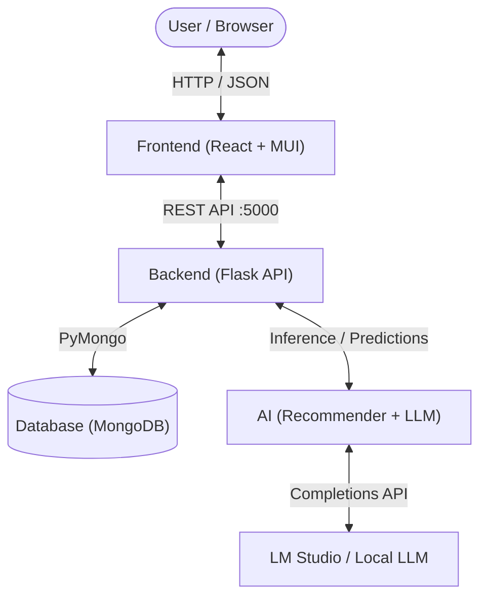
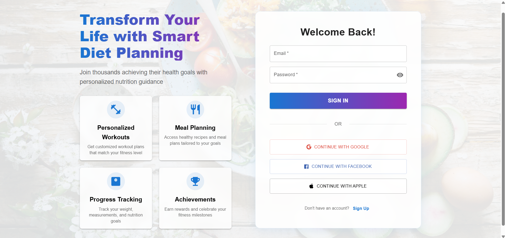
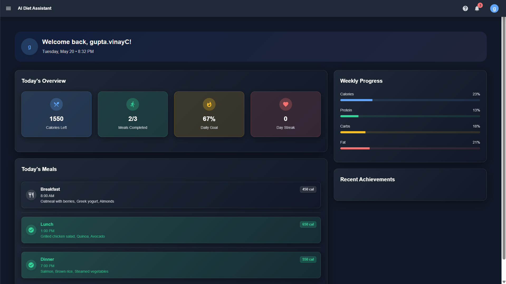
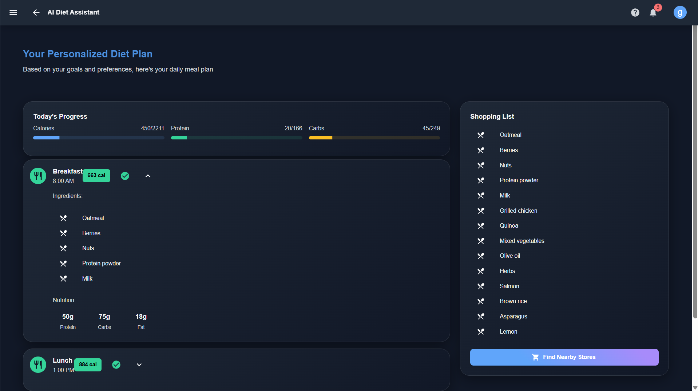
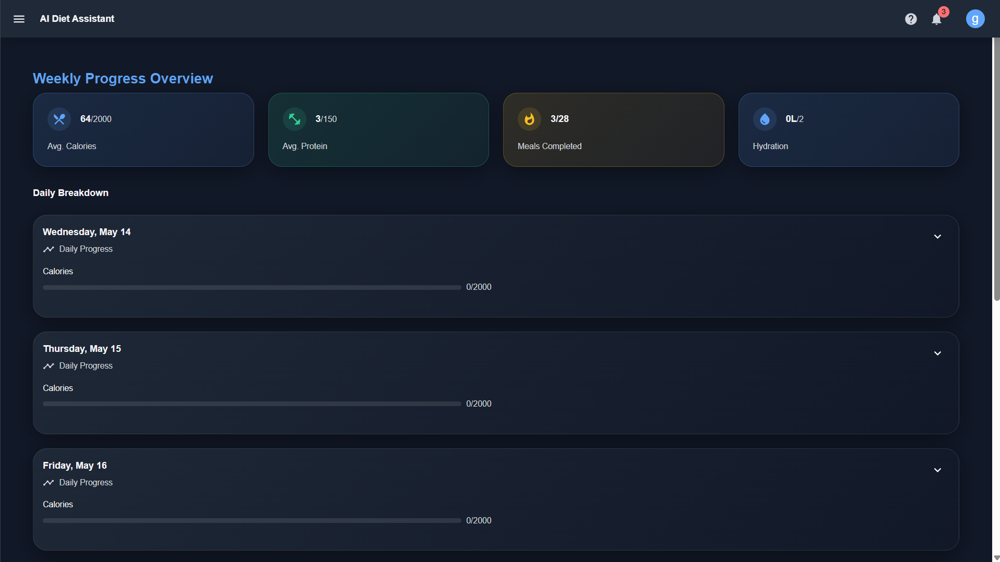

# NutriMind — Intelligent Nutrition, Simplified Living

NutriMind is a full-stack, AI-powered personalized diet and nutrition assistant. Built with modern React web technologies, a Python Flask REST backend, a MongoDB database layer, and Machine Learning / Local LLM integration, NutriMind delivers personalized Indian household meal plans, real-time nutrition analytics, and daily achievement tracking in a stunning, responsive interface.

---

## 🏗️ 4-Tier Modular Architecture

The repository is organized into 4 dedicated, loosely-coupled modules:

```
NutriMind/
├── Frontend/                 # React Technology (React 18/19, TypeScript, Material UI)
├── Backend/                  # Python REST API (Flask, Services, Unit Tests)
├── Database/                 # MongoDB Layer (Schemas, Repositories, Seeder, CSV/JSON Data)
├── AI/                       # Artificial Intelligence & ML (Recommender, LLM, Notebooks)
├── assets/                   # Project screenshots and visual assets
├── .env.example              # Environment variables template
├── requirements.txt          # Unified Python dependencies
└── README.md                 # Project documentation
```



---

## 📂 Module Details

### 1. ⚛️ `Frontend/` (React Technology)
- Built with **React 18/19**, **TypeScript**, and **Material UI (MUI v6)**.
- Features multi-step diet questionnaire, animated progress bars, meal checkboxes, interactive dashboard, and achievement notifications.
- Uses **Framer Motion** for micro-interactions and smooth transitions.
- **Entry point**: `Frontend/src/index.tsx` & `Frontend/src/App.tsx`.

### 2. 🐍 `Backend/` (Python)
- Built with **Flask**, **Flask-CORS**, and Python 3.
- Core business logic partitioned into `Backend/services/`:
  - `user_management.py`: Validation, health metrics, and BMI calculation.
  - `nutritional_analysis.py`: Macronutrient and energy distribution.
  - `health_considerations.py`: Diabetic, cholesterol, and hypertension diet adjustments.
- Includes automated unit tests under `Backend/tests/` (run with `pytest Backend/tests`).
- **Entry point**: `Backend/app.py`.

### 3. 🍃 `Database/` (MongoDB)
- Built with **MongoDB** and **PyMongo**.
- Contains:
  - Document models (`food_model.py`, `user_model.py`, `diet_plan_model.py`).
  - Repository layer (`food_repository.py`, `user_repository.py`, `diet_plan_repository.py`).
  - Seed dataset (`food_database.csv` & `food_database.json`) covering 20+ nutrient-rich food profiles with dietary restriction flags.
  - Automated database seeder (`seed_database.py`).
  - Resilient offline fallback adapter: If MongoDB is not running locally, backend seamlessly continues using the preloaded seed data.

### 4. 🧠 `AI/` (Artificial Intelligence)
- Built with **Scikit-Learn**, **Joblib**, and **Pandas**.
- Contains:
  - `recommendation_engine.py`: ML model inference engine for diet plan classification.
  - `train_model.py`: Training script generating a `RandomForestClassifier` (`models/diet_recommender.pkl`).
  - `diet_generator.py`: Algorithmic constraint solver matching foods to dietary restrictions (vegan, vegetarian, gluten-free, lactose-free).
  - `llm_integration.py`: Local LLM integration (LM Studio, Ollama, OpenAI) for personalized recipe instructions, cooking time, and mood-adaptive meal ideas.
  - `notebooks/data_analysis.ipynb`: Exploratory data analysis and model training notebook.

---

## ⚡ Quickstart Guide

### 1. Prerequisites
- Python 3.10+
- Node.js 18+ and npm
- (Optional) MongoDB local or MongoDB Atlas connection string
- (Optional) [LM Studio](https://lmstudio.ai/) for local AI generation

### 2. Database Setup (MongoDB)
```bash
# Seed initial foods and demo profile into MongoDB
python Database/seed_database.py
```

### 3. Backend Setup (Python)
```bash
# Install Python dependencies
pip install -r requirements.txt

# Run backend server
python Backend/app.py
```
Backend will start on [http://localhost:5000](http://localhost:5000).

### 4. Frontend Setup (React)
```bash
cd Frontend
npm install
npm start
```
Frontend will open on [http://localhost:3000](http://localhost:3000).

---

## 🧪 Running Tests

To verify backend services and AI logic:

```bash
pytest Backend/tests
```

---

## 📸 Screenshots

| Login & Welcome | Dashboard Overview |
|:---:|:---:|
|  |  |

| Weekly Progress Tracking | Personalized Diet Plan |
|:---:|:---:|
|  |  |

---

## 📄 License
This project is licensed under the MIT License. See [LICENSE](LICENSE) for details.
